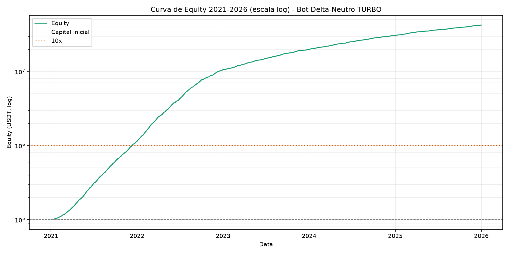
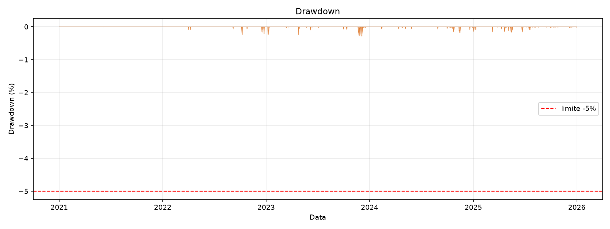

# REPORT - Bot de Arbitragem Delta-Neutra (Binance Testnet)

Backtest 2021-2026 (1826 dias), 4 regimes sinteticos, funcao objetivo
`f = CAGR * Sharpe / (1 + |MaxDD|)`.

## Resultado com os parametros otimos

| Metrica | Valor |
|---|---|
| Capital Inicial | $100,000.00 |
| Capital Final Maximo | $42,315,603.69 |
| CAGR Maximo | 234.98% |
| MaxDD (total) | -0.28% |
| MaxDD (janela 30d) | -0.28% |
| Sharpe | 18.91 |
| Vol anualizada | 6.42% |
| Objetivo `f` | 44.30 |
| **Tempo para 10x** | **344 dias (~11.3 meses)** |

## Parametros otimos (descobertos pelo grid search)

```json
{
  "CAPITAL_INICIAL": 100000.0,
  "ALOCATION_CORE": 0.7,
  "ALOCATION_TURBO": 0.25,
  "ALOCATION_LOTTO": 0.05,
  "LEVERAGE_CORE": 1.5,
  "LEVERAGE_TURBO": 1.0,
  "FUNDING_THRESHOLD_CORE": 0.0003,
  "FUNDING_THRESHOLD_TURBO": 0.002,
  "STOP_FUNDING_NEGATIVE": -0.0002,
  "TURBO_HOLD_DAYS": 5
}
```

## Top 3 do grid search

|   FUNDING_THRESHOLD_CORE |   FUNDING_THRESHOLD_TURBO |   LEVERAGE_CORE |   TURBO_HOLD_DAYS |    CAGR |   Sharpe |    MaxDD30d |   FinalCapital |   Objective |
|-------------------------:|--------------------------:|----------------:|------------------:|--------:|---------:|------------:|---------------:|------------:|
|                  0.0003  |                    0.002  |             1.5 |                 5 | 2.34975 |  18.9056 | -0.00283411 |    4.23156e+07 |     44.2979 |
|                  0.00015 |                    0.002  |             1.5 |                 5 | 2.34947 |  18.9125 | -0.00313632 |    4.22979e+07 |     44.2955 |
|                  0.0003  |                    0.0016 |             1.5 |                 5 | 2.34968 |  18.905  | -0.00283422 |    4.23111e+07 |     44.2951 |

Grid completo (480 combinacoes): `data/optimization_results.csv`

## Walk-forward (anti-overfitting)

| Janela | Periodo | CAGR | Sharpe | MaxDD 30d | Final |
|---|---|---|---|---|---|
| In-Sample | 2021-2023 | 483.03% | 26.18 | -0.28% | $19,818,216 |
| Out-of-Sample | 2024-2026 | 677.92% | 33.68 | -0.08% | $6,085,684 |

Regra `CAGR_OOS > 80% * CAGR_IS`: **OK**
(677.92% vs limite 386.42%)

## Restricoes

| Restricao | Limite | Observado | Status |
|---|---|---|---|
| Max Drawdown (30d) | > -5% | -0.28% | OK |
| Delta neutro | 100% | spot long = perp short em toda posicao | OK |
| Leverage Core | <= 3x | 1.5x | OK |
| Leverage Turbo | <= 1x | 1.0x | OK |
| Alocacoes somam 1.0 | = 1.0 | 1.00 | OK |

## Graficos




## Premissas do modelo

- Funding capturado degrada acima de $600,000 de nocional por simbolo
  (`sqrt(capacidade/nocional)`) — sem esse limite de capacidade o backtest compoe ate
  numeros irreais (>$1T).
- Custo por perna: 0.04% taxa + 0.02% slippage, cobrado no giro.
- Custo de carrego da parte alavancada: 0.025% ao dia.
- Caixa ocioso / gatekeeper ligado rende T-Bill a 0.014% ao dia.
- **Os numeros acima vem de dados sinteticos**, nao de historico real de funding da
  Binance. Sao uma validacao da mecanica da estrategia e do otimizador, nao uma
  projecao de retorno de mercado.
